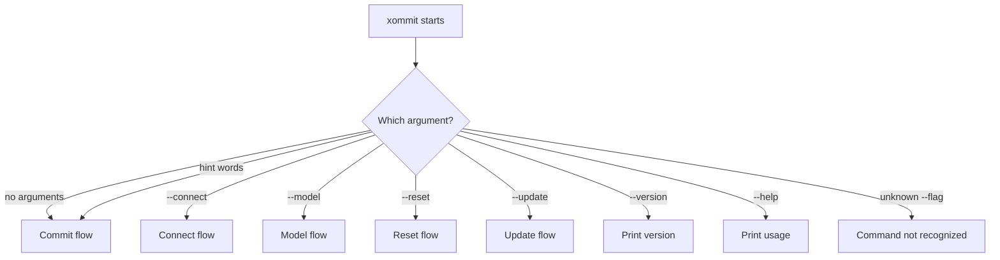

# xommit documentation

This folder is the full reference for xommit. The root [README.md](../README.md) is the quick tour. This is where I document every flow, every branch, and every failure case.

## Start here

| Document | Read it when you want to know |
| --- | --- |
| [getting-started.md](getting-started.md) | How to install and get a first commit |
| [commands.md](commands.md) | What each command and flag does, and what it returns |
| [commit-flow.md](commit-flow.md) | What happens between `xommit` and `git commit` |
| [setup-flow.md](setup-flow.md) | How `--connect` and `--model` work |
| [update-flow.md](update-flow.md) | How `--update` replaces the running binary |
| [configuration.md](configuration.md) | The config file and `.xommitignore` |
| [providers.md](providers.md) | Provider APIs, model ranking, retries, and errors |
| [prompt.md](prompt.md) | The system prompt, response parsing, and validation |
| [context.md](context.md) | How large diffs are trimmed to fit the model |
| [terminal.md](terminal.md) | TTY and non-TTY behavior, picker controls |
| [architecture.md](architecture.md) | Source layout and module responsibilities |
| [testing.md](testing.md) | The three test layers and how to run them |
| [release.md](release.md) | How a release is built, tagged, and published |

## The short version

xommit does one thing well. It takes the changes you already staged, asks an AI provider for three conventional commit messages that describe those changes, lets you pick one, and commits it.

The rules that follow from that:

- xommit only ever reads staged content.
- xommit only ever commits staged content.
- xommit never runs `git add`.
- xommit never pushes, branches, rebases, or changes history.
- xommit sends your diff to a third-party provider. If that matters for your project, use `.xommitignore` to keep sensitive files out of the request.

## Flow overview

Each of those flows is documented in detail:

- [Commit flow](commit-flow.md)
- [Connect flow](setup-flow.md)
- [Model flow](setup-flow.md)
- [Update flow](update-flow.md)

## Where things live

| Path | Purpose |
| --- | --- |
| `cli/src/` | All C++ implementation |
| `cli/include/xommit/` | All C++ headers |
| `cli/scripts/` | Build script, npm shim, installers, release script |
| `cli/tests/` | Unit tests and the Node test runner |
| `cli/package.json` | Version source of truth |
| `.github/workflows/release.yml` | Release automation |
| `notes/` | Early design notes, kept for history |

## Conventions used in these docs

- Exit code `0` means the command succeeded.
- Exit code `1` means the command failed or was cancelled.
- "The index" always means the git staging area.
- A "hint" is the optional text you pass to `xommit`, for example `xommit "fix parser"`.
