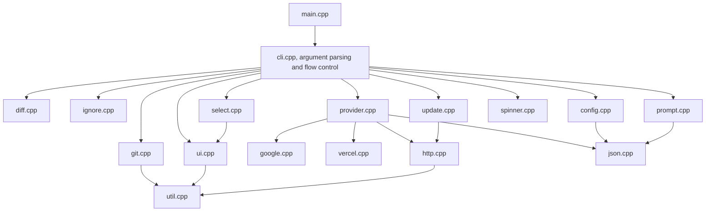

# Architecture

This describes how the source is organized and how the pieces fit together.

## Layout

```text
cli/
  include/xommit/   headers, one per area
  src/              implementation, one .cpp per area
  scripts/          build, npm shim, installers, release
  tests/            unit tests and the Node runner
  package.json      version source of truth
```

## The layers



`util.cpp` is the shared helper layer. `json.cpp` is a small hand written parser and serializer used by the config, the provider responses, and the prompt parser. `http.cpp` is the WinHTTP wrapper used by both providers and by the updater.

## Module responsibilities

| File | Responsibility |
| --- | --- |
| `main.cpp` | `wmain`, UTF-8 console setup, VT enable, top level exception handling |
| `cli.cpp` | Argument parsing, commit flow, connect flow, model flow, reset flow |
| `config.cpp` | Load, save, and delete `%APPDATA%\xommit\config.json` |
| `diff.cpp` | Diff parsing, context budgeting, trimming, token estimation |
| `ignore.cpp` | Built-in patterns, `.xommitignore` parsing, glob matching |
| `git.cpp` | `git diff --cached`, `git rev-parse`, `git commit` |
| `prompt.cpp` | System prompt, user prompt builder, response parsing, validation, sanitizing |
| `provider.cpp` | Provider factory, model ranking, model labels, error messages |
| `google.cpp` | Google AI Studio list and generate calls |
| `vercel.cpp` | Vercel AI Gateway list and generate calls |
| `http.cpp` | WinHTTP requests with timeouts and downloads |
| `json.cpp` | JSON parser and serializer |
| `update.cpp` | GitHub release lookup, download, binary swap |
| `ui.cpp` | Logo, colors, password input, cursor control, line clearing, TTY checks |
| `select.cpp` | Interactive picker and numbered fallback |
| `spinner.cpp` | Single line spinner |
| `util.cpp` | Strings, paths, environment, filesystem, UTF-8 and UTF-16 conversion |

## Headers

| Header | Exposes |
| --- | --- |
| `cli.h` | `run_cli` |
| `config.h` | `Config`, `load_config`, `save_config`, `reset_config`, `config_exists`, `config_path` |
| `diff.h` | `DiffFile`, `parse_diff`, `build_diff_context`, `context_budget_chars`, `estimate_tokens` |
| `git.h` | `git_diff_cached`, `git_commit`, `git_commit_no_args`, `git_repo_root` |
| `ignore.h` | `IgnoreRules` |
| `json.h` | `Json` |
| `model.h` | `ModelSpec` |
| `prompt.h` | `system_prompt`, `build_user_prompt`, `parse_commit_options`, `sanitize_message` |
| `provider.h` | `Provider`, `make_provider`, `provider_ids`, `provider_label`, `rank_models`, `format_model`, `ProviderError`, `http_error_message` |
| `http.h` | `HttpResponse`, `http_request`, `http_download` |
| `select.h` | `select_option` |
| `spinner.h` | `Spinner` |
| `ui.h` | Logo, colors, TTY checks, password and line reading |
| `update.h` | `update_binary`, `current_version`, `install_dir`, `exe_path`, `version_file_path`, `cleanup_old_binary` |
| `util.h` | String and path helpers |
| `version.h` | `XOMMIT_VERSION`, `XOMMIT_REPO`, `XOMMIT_ASSET`, generated from `package.json` |

## Running git

Two different mechanisms are used, on purpose.

**Reads** use `CreateProcessW` with redirected pipes. stdout and stderr are drained by two reader threads, so a large diff cannot fill a pipe buffer and deadlock. The process is started with `CREATE_NO_WINDOW` so no console flashes.

```sh
git -c core.quotepath=false diff --cached --no-color --no-ext-diff --no-textconv -M
git rev-parse --show-toplevel
```

**Writes** use `CreateProcessW` with inherited standard handles. Git's output, hooks, and editor behavior are shown exactly as if you had run git yourself.

```sh
git commit -m "<message>"
```

The message is converted to UTF-16 and quoted with the Windows command line rules. This is what fixed the bug where a multi-word message was split into pathspecs and git complained that `throw` did not match any file.

## Error handling

Errors are C++ exceptions.

| Exception | Meaning |
| --- | --- |
| `std::runtime_error` | General failure with a user facing message |
| `ProviderError` | An HTTP failure from a provider, carries the status code |

`ProviderError::retryable()` returns true for 5xx statuses. The retry wrapper in `cli.cpp` catches retryable provider errors and any other exception and tries once more.

`main.cpp` catches anything that escapes and prints it as `error: <message>` with exit code 1.

## The build

`cli/scripts/build.js` is the single entry point.

```text
g++ -std=c++20 -O2 -Wall -Wextra -municode -DUNICODE -D_UNICODE
    -DXOMMIT_VERSION="<version from package.json>"
    -DXOMMIT_REPO="abhraneeldhar7/xommit"
    -DXOMMIT_ASSET="xommit.exe"
    -Iinclude src/*.cpp
    -o bin/xommit.exe
    -static -static-libgcc -static-libstdc++ -lwinhttp
```

- `src/*.cpp` is every `.cpp` in `src`, sorted, so the build is deterministic.
- `-municode` matches the `wmain` entry point.
- Static linking means the release binary has no runtime dependencies.
- `-lwinhttp` is the only external library, and it ships with Windows.

`cli/package.json` is the version source of truth. The same script is used by the release workflow and by the release helper.

Next: [testing.md](testing.md)
