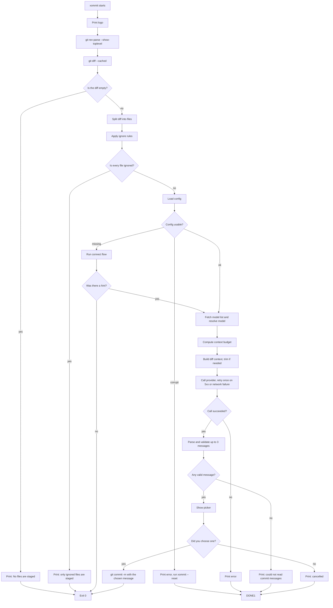

# The commit flow

This is the main flow. It starts when you run `xommit` or `xommit "<hint>"` and ends when git commits or xommit gives up.

## The diagram



## Step by step

### 1. Logo

The logo prints first. On a TTY at least 80 columns wide it is the six line ASCII banner. On a narrow terminal or a non-TTY it is a single plain `xommit` line with no escape codes.

### 2. Repository root

xommit runs `git rev-parse --show-toplevel`. If that fails you get the git error, most often `not a git repository`.

The root is used to find `.xommitignore`.

### 3. Read the staged diff

```sh
git -c core.quotepath=false diff --cached --no-color --no-ext-diff --no-textconv -M
```

- `core.quotepath=false` keeps non-ASCII file names readable.
- `--no-color` keeps the output plain.
- `--no-ext-diff` stops external diff drivers from running.
- `--no-textconv` keeps binary detection predictable.
- `-M` detects renames so a rename is one entry instead of a delete and an add.

Only staged content is read. Unstaged work is never touched.

### 4. Nothing staged

If the diff is empty, xommit prints `No files are staged` and exits 0. It does not call the provider and it does not run `git commit`.

### 5. Split into files

The diff is split on `diff --git` headers. For each file xommit collects:

- The path, taken from the `+++` side when it exists, otherwise the `---` side, otherwise the rename lines.
- The body, starting at the first `@@` hunk header.

Header lines are dropped: `index`, `---`, `+++`, `new file mode`, `deleted file mode`, `old mode`, `new mode`, `similarity index`, `dissimilarity index`, `rename from`, `rename to`, `copy from`, `copy to`.

Binary files are detected from `Binary files ...` or `GIT binary patch` and replaced with `(binary file)`.

A file with a valid header but no hunks becomes `(no content changes)`.

### 6. Ignore rules

Every file is checked against the built-in patterns and your `.xommitignore`. See [configuration.md](configuration.md).

### 7. Everything ignored

If every staged file is ignored, xommit prints `only ignored files are staged, nothing to send to the AI` and exits 0. The index is not changed.

### 8. Load the config

The config is read from `%APPDATA%\xommit\config.json`.

There are three possible outcomes:

| Config state | What happens |
| --- | --- |
| Complete and valid | The flow continues |
| File missing | The connect flow runs, then the commit continues if you passed a hint |
| File present but corrupt or incomplete | xommit prints the error, tells you to run `xommit --reset`, and exits 1 |

The corrupt case is deliberately not treated as "no config". If I silently started the connect flow there, you would lose your key for no reason.

### 9. Resolve the model

xommit fetches the provider model list and looks for the saved `model_id`. This gives the real context window and output limit for the budget calculation, and it fails early with `failed to resolve model: ...` if the model no longer exists.

### 10. Budget the context

The budget decides how many characters of diff can be sent. See [context.md](context.md) for the full math.

### 11. Build the prompts

The user prompt is:

```
User hint: <your hint, or (none)>

<diff context>
```

Each file in the context looks like this:

```
<src/parser.cpp>
@@ -1,4 +1,6 @@
-old line
+new line
</src/parser.cpp>
```

If the context had to be trimmed, a note is added at the top:

```
Note: some diffs were truncated to fit the context window.
```

Truncated files end with `... truncated`.

### 12. Call the provider

The request carries the system prompt, the user prompt, a temperature of 0.2, and an output limit of at most 512 tokens.

Network failures and 5xx responses are retried once. A 401, 403, or 429 is final. See [providers.md](providers.md).

If every attempt fails, xommit prints `Can't reach AI models` for network style failures and the provider message otherwise, then exits 1.

### 13. Parse the response

Up to three messages are extracted, validated, cleaned, and deduplicated. See [prompt.md](prompt.md).

If nothing valid survives, xommit prints `could not read commit messages from the model response` and exits 1.

### 14. Pick a message

The picker shows the options. See [terminal.md](terminal.md).

Cancelling prints `cancelled` and exits 1. Nothing is committed.

### 15. Commit

The chosen message is flattened to a single line, whitespace is collapsed, and it is passed to:

```sh
git commit -m "<message>"
```

The message is quoted using the Windows command line rules, so spaces, quotes, and non-ASCII text all survive. The earlier bug where a multi-word message was split into pathspecs is fixed by this quoting.

Git's own output is shown, including hooks. xommit exits with git's exit code.

## Scenarios

### Nothing staged

```
xommit
```

```
No files are staged
```

Exit code 0. No provider call.

### Everything staged is ignored

```
xommit
```

```
only ignored files are staged, nothing to send to the AI
```

Exit code 0. No provider call. The staged files are still there for you to commit yourself.

### No config, no hint

```
xommit
```

The connect flow opens. After you save a config, xommit stops and waits for your next run.

### No config, with a hint

```
xommit "fix parser"
```

The connect flow opens. After you save a config, the commit flow continues with the same hint.

### Corrupt config

```
xommit
```

```
error: config file is corrupt, run xommit --reset
```

Exit code 1. The key in the file is left untouched.

### Provider returns something unusable

```
error: could not read commit messages from the model response
```

Exit code 1. Nothing is committed.

### You cancel the picker

```
cancelled
```

Exit code 1. Nothing is committed.

### Git refuses the commit

Git prints its own message, for example `nothing to commit` or a hook failure. xommit exits with git's exit code.

### A very large diff

The diff is trimmed to fit the context window. The model is told that some diffs were truncated and is instructed to describe only the visible changes. The chosen message can be less precise than it would be on a small diff. This is expected.

### Binary files only

Binary files are sent as `(binary file)`. The model can see that something changed but not what changed inside the file.

### A rename

With `-M`, a rename is one file entry with the new path. The model sees the new path and the hunks.

Next: [setup-flow.md](setup-flow.md)
