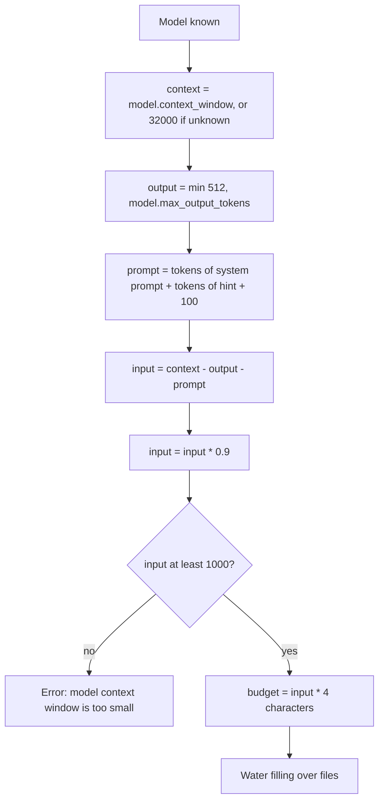
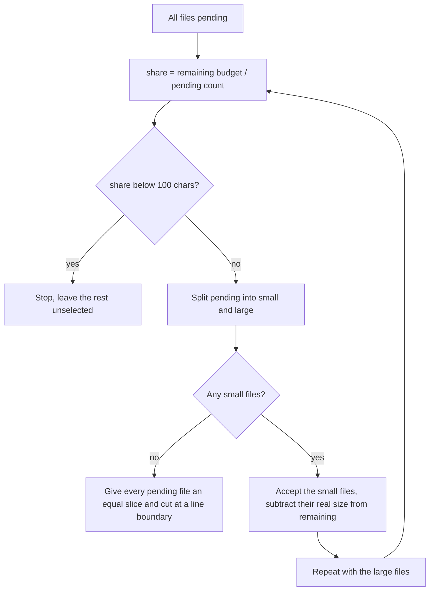

# Context budgeting

A large diff can be bigger than the model context window. xommit trims the diff so the request always fits.

## The budget formula



In code:

```text
context = model.context_window > 0 ? model.context_window : 32000
output  = model.max_output_tokens > 0 ? min(512, model.max_output_tokens) : 512
prompt  = estimate_tokens(system_prompt) + estimate_tokens(hint) + 100
input   = context - output - prompt
input   = input * 9 / 10
if (input < 1000) error
budget  = input * 4
```

`estimate_tokens` divides the character count by four and rounds up. It is an approximation, not a tokenizer, but it is consistent and it keeps the calculation cheap.

The 90 percent factor leaves headroom for provider side counting differences and for the JSON envelope around the diff.

The output reserve is the same 512 token value that is sent as `maxOutputTokens` or `max_tokens`, so the reservation and the request agree.

## Water filling

The budget is then spent across files.



The cost of a file is its path length plus its body length plus 20 characters for the wrapper tags.

- Files that fit inside the current share are accepted whole, and their real cost is subtracted from the remaining budget.
- The remaining files get a bigger share on the next round, because the accepted ones no longer compete for budget.
- When no file fits in the share, every remaining file gets an equal slice and is cut at a line boundary.

A file that is cut gets `... truncated` at the end.

## The result

```text
Note: some diffs were truncated to fit the context window.

<src/large.cpp>
@@ ...
... truncated
</src/large.cpp>
```

The note appears when any file was dropped or cut. The system prompt tells the model to describe only the visible changes in that case.

## Failure cases

| Condition | Error |
| --- | --- |
| The model context window is too small for the prompt and output reserve | `model context window is too small` |
| The budget is zero or negative | `model context window is too small` |
| Nothing fits at all | `no diff content fits in the model context window` |

The first case can happen with a very small model. The second is a guard. The third means the files are too large even after splitting.

## Practical numbers

For `gemini-2.5-flash-lite` with a one million token window, the budget is far larger than any realistic diff, so nothing is trimmed.

For a model with a 32,000 token window:

```text
context = 32000
output  = 512
prompt  = about 800
input   = 30688 * 0.9 = 27619 tokens
budget  = about 110000 characters
```

So roughly 110 KB of diff text fits in one request against a 32k model.

## What is not counted

- The provider's JSON envelope around the diff.
- The exact token cost of the diff, which depends on the tokenizer.
- The response, which is capped separately at 512 tokens.

Next: [terminal.md](terminal.md)
