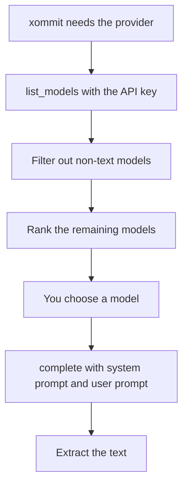

# Providers

xommit talks to two providers. Both use a plain API key and a model id. Both are implemented in `cli/src/google.cpp` and `cli/src/vercel.cpp`, and both share the HTTP layer in `cli/src/http.cpp`.

## Overview



## Google AI Studio

| | |
| --- | --- |
| Base URL | `https://generativelanguage.googleapis.com/v1beta` |
| Auth header | `x-goog-api-key: <key>` |
| Model list | `GET /models?pageSize=1000` |
| Generate | `POST /models/<id>:generateContent` |

### Model list

A model is kept when:

- `supportedGenerationMethods` contains `generateContent`, if the field is present at all.
- The id does not contain `embedding`, `aqa`, `tts`, `audio`, `image`, `vision`, `robotics`, `computer-use`, or `transcribe`.

The `models/` prefix is stripped from the id. `inputTokenLimit` becomes the context window and `outputTokenLimit` becomes the output limit.

### Ranking

Google models are sorted by a score:

| Score | Model family |
| --- | --- |
| 1 | `flash-lite` |
| 2 | `flash` |
| 3 | `pro` |
| 50 | Everything else |
| 100 | Preview, experimental, tts, audio, image, robotics, computer-use |

Ties break on a larger context window, then on the model id. `flash-lite` and `flash` are marked free.

### Generate request

```json
{
  "systemInstruction": {
    "parts": [{ "text": "<system prompt>" }]
  },
  "contents": [
    { "role": "user", "parts": [{ "text": "<user prompt>" }] }
  ],
  "generationConfig": {
    "temperature": 0.2,
    "maxOutputTokens": 512
  }
}
```

The response text is read from `candidates[0].content.parts[].text`.

## Vercel AI Gateway

| | |
| --- | --- |
| Base URL | `https://ai-gateway.vercel.sh/v1` |
| Auth header | `Authorization: Bearer <key>` |
| Model list | `GET /models` |
| Generate | `POST /chat/completions` |

### Model list

A model is kept when:

- `type` is `language`.
- The output modalities include `text`, if the field is present at all.
- The id does not contain `tts`, `audio`, `image`, `vision`, `robotics`, `computer-use`, `embedding`, `rerank`, `video`, `transcribe`, or `speech`.

`context_window` and `max_tokens` are taken directly from the response. Prices come from `pricing.input` and `pricing.output`. A model is free when both are zero.

### Ranking

Vercel models are sorted by a computed score:

| Adjustment | Condition |
| --- | --- |
| -10000 | The model is free |
| -5000 | Combined price is above 0 and at or below 0.000001 |
| Up to -1000 | Larger context window, in steps of 1000 tokens |
| Up to -100 | Larger output limit, in steps of 100 tokens |
| +10000 | The id contains preview, exp, beta, alpha, tts, audio, image, vision, robotics, computer-use, embedding, or rerank |

Ties break on the lower combined price, then the larger context window, then the model id.

### Generate request

```json
{
  "model": "<id>",
  "messages": [
    { "role": "system", "content": "<system prompt>" },
    { "role": "user", "content": "<user prompt>" }
  ],
  "temperature": 0.2,
  "max_tokens": 512
}
```

The response text is read from `choices[0].message.content`, which is either a string or an array of parts.

## Model labels in the picker

```text
gemini-2.5-flash-lite  Free  (recommended)
gemini-2.5-flash  Free
gemini-2.5-pro
```

Only the first model in the ranked list gets the `(recommended)` marker.

## Output limit

Every request asks for at most 512 output tokens. If the model reports a lower maximum, the lower value wins. The same number is reserved when the diff context is budgeted, so the request always fits.

## Errors

| Status | Message | Retried |
| --- | --- | --- |
| 401 | `API key rejected (401). Run xommit --connect.` | No |
| 403 | `access denied (403). <detail>` | No |
| 429 | `rate limit or quota exceeded (429). <detail>` | No |
| 5xx | `provider server error (<status>). <detail>` | Once |
| Other 4xx | `provider error (<status>). <detail>` | No |
| Network failure | WinHTTP error text | Once |

The detail is extracted from the `error.message` field or the `message` field of the response body. If neither exists, the raw body is used. The detail is collapsed to one line and cut to 500 characters.

A retry is the same request sent again. It is not a different model and not a different key.

## Timeouts

WinHTTP is configured with:

| Phase | Timeout |
| --- | --- |
| Resolve | 10 seconds |
| Connect | 10 seconds |
| Send | 30 seconds |
| Receive | 60 seconds |

A timeout is reported as a WinHTTP error, which counts as a network failure and is retried once.

## Proxy handling

The HTTP session is opened with automatic proxy resolution. If that fails, it falls back to the default proxy configuration. This picks up system and environment proxy settings without extra configuration.

## What is sent to the provider

For every request:

- The system prompt, which is fixed and contains no user data.
- The user hint you typed.
- The diff context, which is the staged diff after ignore rules and context trimming.

Nothing else. No file contents from outside the index, no git config, no user name, no email address.

Next: [prompt.md](prompt.md)
