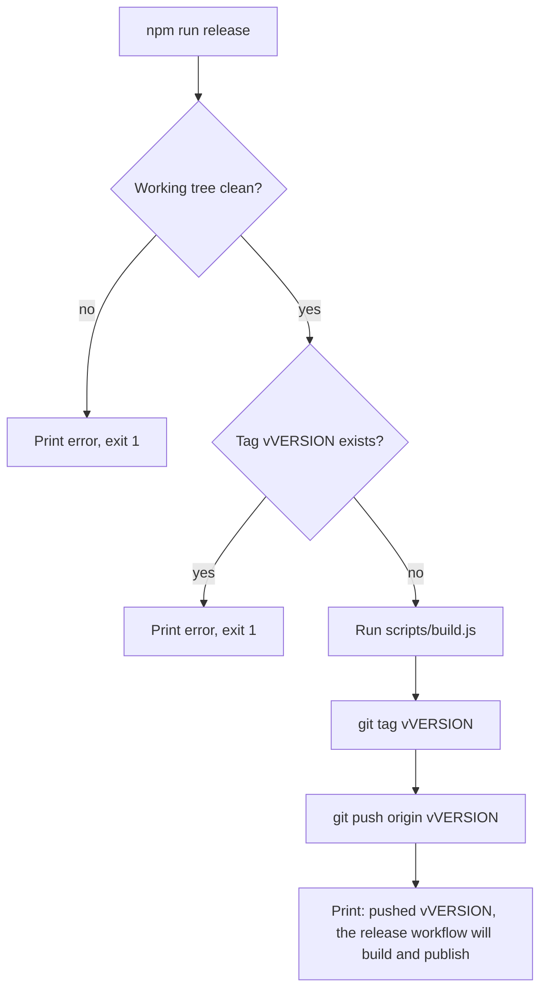
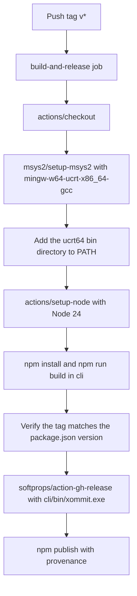

# Building and releasing

This covers the local build, the release script, and the GitHub Actions workflow.

## The version

`cli/package.json` is the single source of truth for the version. The build script reads it and passes it into the binary as `XOMMIT_VERSION`, so the binary, the npm package, and the git tag can never disagree.

```json
{
  "version": "<version>"
}
```

## Building locally

```sh
cd cli
npm install
npm run build
```

Output: `cli/bin/xommit.exe`

### The compiler command

```text
g++ -std=c++20 -O2 -Wall -Wextra -municode -DUNICODE -D_UNICODE
    -DXOMMIT_VERSION="<version>"
    -DXOMMIT_REPO="abhraneeldhar7/xommit"
    -DXOMMIT_ASSET="xommit.exe"
    -Iinclude src/*.cpp
    -o bin/xommit.exe
    -static -static-libgcc -static-libstdc++ -lwinhttp
```

| Flag | Why |
| --- | --- |
| `-std=c++20` | The code uses C++20 features |
| `-O2` | Release optimization |
| `-Wall -Wextra` | Warnings are enabled and the build is expected to be clean |
| `-municode` | The entry point is `wmain` |
| `-DUNICODE -D_UNICODE` | Windows wide APIs |
| `-static` | No runtime DLL dependencies |
| `-static-libgcc -static-libstdc++` | No libgcc or libstdc++ DLLs |
| `-lwinhttp` | The only external library, and it ships with Windows |

### Requirements

- MinGW-w64 UCRT64 GCC with POSIX threads. The code uses `std::thread`, which needs the POSIX threading model.
- Node.js 18 or newer.

## Releasing

```sh
cd cli
npm run release
```

The release script:

1. Checks that the working tree is clean.
2. Checks that the tag does not already exist.
3. Builds the binary.
4. Creates the tag `v<version>`.
5. Pushes the tag.



## The GitHub Actions workflow

File: `.github/workflows/release.yml`

It runs on `windows-latest` when a tag matching `v*` is pushed.



### Steps in detail

| Step | What it does |
| --- | --- |
| Checkout | `actions/checkout@v4` |
| Setup MSYS2 | `msys2/setup-msys2@v2` with `msystem: UCRT64` and `install: mingw-w64-ucrt-x86_64-gcc` |
| Add MinGW to PATH | Appends the `ucrt64\bin` directory from the action's `msys2-location` output to `GITHUB_PATH` |
| Setup Node | `actions/setup-node@v4` with Node 24 and the npm registry |
| Build | `npm install` then `npm run build` in `cli` |
| Verify version | Fails the job when the tag does not equal `v<package.json version>` |
| Create GitHub Release | `softprops/action-gh-release@v2` with `cli/bin/xommit.exe` as the asset and generated release notes |
| Publish to npm | `npm publish --provenance --access public` |

### Permissions

```yaml
permissions:
  contents: write
  id-token: write
```

`contents: write` lets the release action create the release. `id-token: write` lets npm authenticate through trusted publishing and generate provenance without a long lived token.

### The npm package

The published package contains only:

```text
scripts/index.js
scripts/install.ps1
scripts/install.sh
README.md
```

The binary itself is not in the npm package. The shim downloads `xommit.exe` from the GitHub release on first run, which is why the release step runs before the publish step.

### The version guard

The workflow fails when the tag does not match the package version. For example, a `v1.2.0` tag with `1.1.0` in `package.json` stops the job before anything is published. This keeps the npm version and the release asset in sync.

## A full release checklist

1. Update the version in `cli/package.json`.
2. Run `npm test` from `cli/`.
3. Update `cli/README.md` if the behavior changed.
4. Commit the version bump with a conventional commit.
5. Run `npm run release` from `cli/`.
6. Watch the workflow on GitHub.
7. Confirm the release asset downloads and runs.

## SmartScreen

The binaries are not code signed. Windows SmartScreen may show a warning the first time you run a downloaded `xommit.exe`. The npm route avoids this for most users because the executable is downloaded by the shim rather than by the browser.

Next: back to the [documentation index](README.md)
