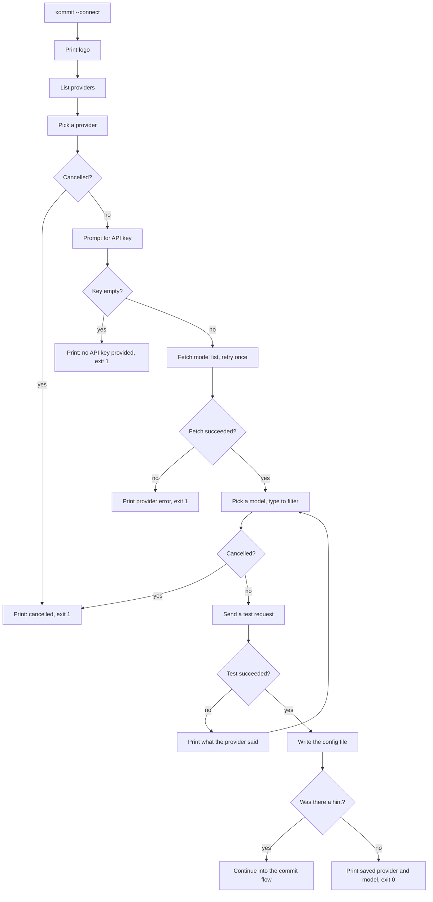
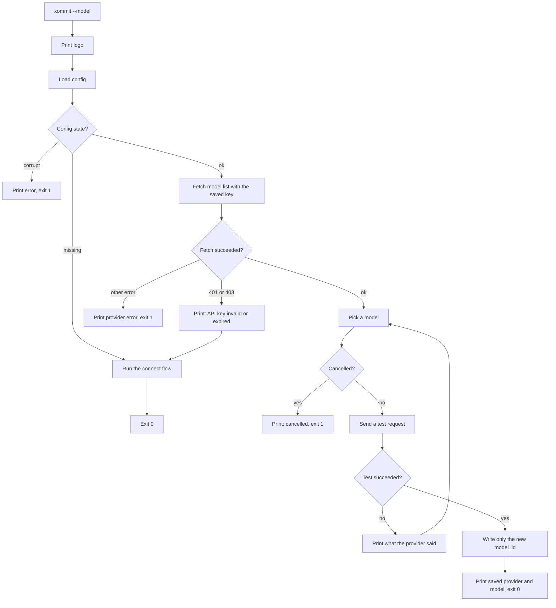
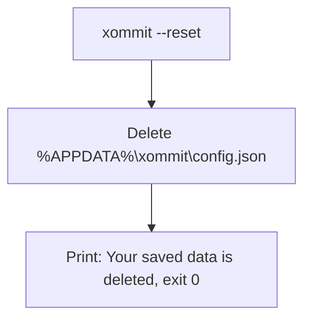

# Setup flows

This covers `xommit --connect` and `xommit --model`. Both end with a working provider and model in `%APPDATA%\xommit\config.json`.

## Connect flow



### Step by step

**Provider list.** The list is fixed: Google AI Studio first, marked as recommended, then Vercel AI Gateway.

**API key.** The prompt does not echo your typing. It shows `*` for each character. Backspace works. Esc cancels and returns an empty key. Ctrl+C exits with code 130.

If the key is empty after trimming, xommit prints `no API key provided` and exits 1.

**Model list.** xommit calls the provider's list endpoint and ranks the results. See [providers.md](providers.md) for the ranking rules.

The model picker shows the model id, a `Free` marker for free models, and a `(recommended)` marker on the first entry. You can type to filter, use arrow keys, PageUp and PageDown, Home and End, and press Enter to choose.

**Test request.** After you choose a model, xommit sends a tiny request to it. This catches a key that lists models but cannot generate, or a model that is not actually available on your account.

If the test fails, the provider error is printed and the model list is shown again. Your key is kept, so you can try another model without typing it again.

**Saving.** The config file is written to `%APPDATA%\xommit\config.json`:

```json
{
  "provider": "google",
  "api_key": "your-api-key",
  "model_id": "gemini-2.5-flash-lite"
}
```

**Continuing into the commit flow.** If `--connect` was reached from the commit flow and you had passed a hint, xommit clears the success message and continues with that hint. If you had no hint, xommit stops after saving. You run `xommit` again when you are ready.

## Model flow



The model flow differs from the connect flow in three ways:

- The provider and the API key stay as they are.
- Only `model_id` is rewritten in the config file.
- If the key is rejected, xommit falls back to the full connect flow so you can replace it.

## Config file states

`load_config` distinguishes three states, and the behavior is different for each.

| State | How it is detected | Result |
| --- | --- | --- |
| Missing | The file does not exist | The connect flow runs |
| Empty | The file exists but has no content | `no saved credentials` |
| Corrupt | The file has content but is not valid JSON | `config file is corrupt, run xommit --reset` |
| Incomplete | Valid JSON but `provider`, `api_key`, or `model_id` is missing or empty | `config file is incomplete, run xommit --reset` |

The corrupt and incomplete cases exit 1 and leave the file in place so you can inspect or recover the key manually.

## Reset flow



The delete is best effort. If the file is not there, the command still succeeds.

Next: [update-flow.md](update-flow.md)
