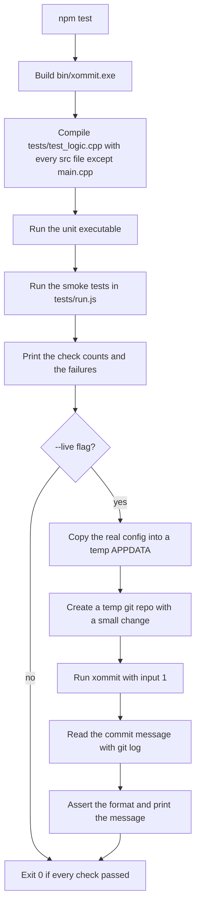

# Testing

xommit has three test layers. Each one answers a different question, and each one costs something different.

| Layer | Question | Network | Credits | Speed |
| --- | --- | --- | --- | --- |
| Unit | Do the pure functions behave correctly? | No | None | Seconds |
| Smoke | Does the built executable behave correctly as a process? | No | None | Seconds |
| Live | Does the real provider return usable commit messages? | Yes | Yes | 10 to 30 seconds |

There is no test framework. The unit tests are a plain C++ executable and the runner is plain Node, so the suite has no dependencies to install.

## Running the tests

From `cli/`:

```sh
npm test
```

That builds `bin/xommit.exe`, compiles and runs the unit tests, then runs the smoke tests against the built binary.

```sh
npm run test:live
```

That runs everything above and then calls the provider configured in your real config file. It spends API credits and needs a valid config. Do not run it in CI.

Requirements:

- MinGW `g++` on PATH, or set `CXX`
- `git` on PATH
- Node.js 18 or newer

## The flow of a test run



## Unit tests

File: `cli/tests/test_logic.cpp`

The runner compiles every file in `src/` except `main.cpp` together with the test file. That means the tests also catch compile errors in the real sources.

Covered:

| Area | What is checked |
| --- | --- |
| `sanitize_message` | Whitespace collapsing, quote removal, trailing period removal, the 72 character limit, UTF-8 safety at the cut point |
| `parse_commit_options` | JSON object, JSON array, fenced JSON, prose fallback, bullet prefixes, numbered prefixes, duplicates, malformed entries, double type prefixes |
| `parse_diff` | Modified, added, deleted, renamed, and binary files, plus paths that contain spaces |
| `build_diff_context` | Empty input, truncation, budget limits, binary markers |
| `context_budget_chars` | The budget formula and its failure case |
| `estimate_tokens` | The character to token approximation |
| `IgnoreRules` | Built-in patterns, nested paths, `.xommitignore`, negation, glob matching |
| `Json` | Parsing, dumping, escapes, unicode, invalid input |
| `Config` | Save, load, corrupt file, incomplete file, reset |
| `git_commit` | Multi-word messages, quotes, backslashes, UTF-8, a trailing backslash |

### The commit regression test

The `git_commit` test exists because of a real bug. `_wspawnvp` does not quote arguments, so a commit message with spaces was split into multiple arguments and git treated them as pathspecs. The error looked like this:

```text
error: pathspec 'throw' did not match any file(s) known to git
```

The test commits a message containing spaces, quotes, a backslash, and non-ASCII text, then reads the message back with `git log` and compares it. The fix was to use `CreateProcessW` with proper Windows argument quoting.

## Smoke tests

File: `cli/tests/run.js`

Every case spawns `bin/xommit.exe` with an isolated `APPDATA` and `LOCALAPPDATA` under a temporary directory. Your real config is never touched. Temporary git repositories are created under the same directory.

Covered:

- `--version` and `-v`
- `--help` and `-h`, including every documented flag
- Unknown flags
- `--reset` with and without a config
- Running outside a git repository
- An empty index
- Only ignored files staged
- A missing config starts the connect flow
- A corrupt config prints the corrupt error instead of silently reconnecting
- An incomplete config prints the incomplete error
- `--connect` cancel, an invalid choice, and an empty key
- `--model` without a config
- No ANSI escape codes when stdout is not a TTY

The smoke tests pass `input: ""` on purpose. That makes stdin a pipe, which exercises the non-interactive paths and the numbered picker fallback.

## Live tests

File: `cli/tests/run.js`, function `liveTests`

The live test:

1. Copies `%APPDATA%\xommit\config.json` into an isolated temporary `APPDATA`.
2. Creates a temporary git repository with a small bug fix.
3. Runs the full commit flow with the input `1`.
4. Reads the resulting commit message with `git log`.

It asserts that the message is conventional, at most 72 characters, a single line, and has no trailing period. It prints the message so you can judge the quality yourself.

It does not assert the exact type or wording. Model output is stochastic, so exact assertions would be flaky. Review the printed message whenever you change the prompt.

### Rate limits

The live test uses the same provider and model you have configured. Free tiers usually allow around five requests per minute, and the live suite makes several in quick succession. If you hit a rate limit, wait about a minute and run it again.

## Isolation

| Layer | Isolation |
| --- | --- |
| Unit | Unique temp directories, removed at the end |
| Smoke | A temporary `APPDATA`, `LOCALAPPDATA`, and git repository |
| Live | The real config is copied into a temporary `APPDATA`. The real file is only read |

`--update` is not tested automatically because it replaces binaries and talks to GitHub. Test it by hand in a throwaway `LOCALAPPDATA`.

## Running in CI

The automated layers work on `windows-latest`:

```yaml
- name: Setup MSYS2
  uses: msys2/setup-msys2@v2
  with:
    msystem: UCRT64
    update: false
    install: mingw-w64-ucrt-x86_64-gcc

- name: Add MinGW to PATH
  run: echo "C:\msys64\ucrt64\bin" | Out-File -FilePath $env:GITHUB_PATH -Encoding utf8 -Append

- name: Test
  working-directory: cli
  run: npm test
```

Never run `npm run test:live` in CI.

## Changing the prompt

When you change `SYSTEM_PROMPT` in `cli/src/prompt.cpp`:

1. Run `npm test` to confirm parsing and validation still work.
2. Run `npm run test:live` a few times with different diffs.
3. Check every option:
   - Uses a valid type
   - Describes the whole diff, not one file
   - Uses a real scope, not a file name
   - Stays under 72 characters
   - Has no trailing period

A useful manual check is to stage a docs-only change, a refactor, a CI change, and a multi-file feature, then run the CLI with stdin closed so you can see the options without committing:

```sh
"" | xommit
```

## Adding tests

| What you are testing | Where |
| --- | --- |
| Pure logic | `cli/tests/test_logic.cpp`, using `check`, `check_eq`, or `check_eq_int` |
| Process behavior | `cli/tests/run.js`, using `runCli` and `checkContains` |

Keep every test independent, use temp directories, and add a regression test for every bug you fix.

Next: [release.md](release.md)
