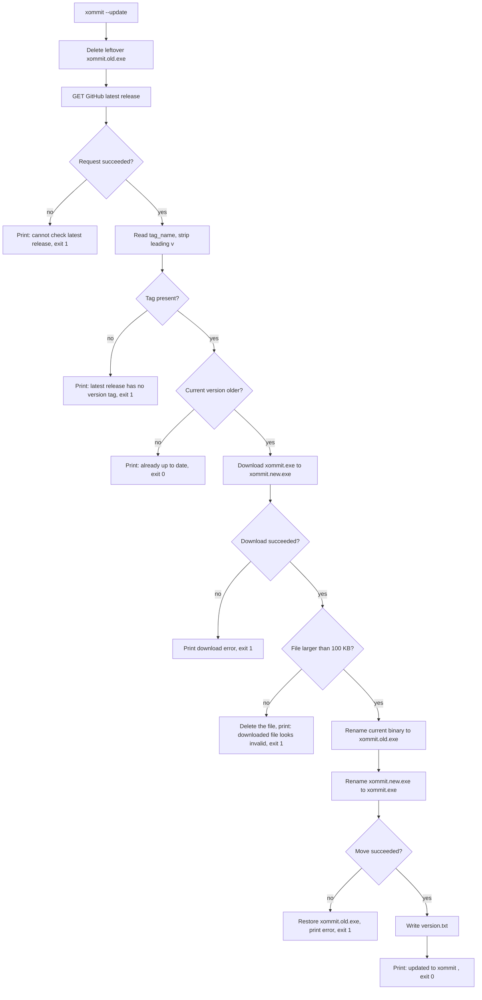

# Update flow

`xommit --update` replaces the running binary with the latest published release.

## The diagram



## Step by step

**Cleanup.** Every xommit start deletes a leftover `xommit.old.exe`. This is why the old binary only survives until the next run.

**Latest version lookup.** xommit calls:

```sh
GET https://api.github.com/repos/abhraneeldhar7/xommit/releases/latest
```

with a `User-Agent` of `xommit/<version>`. The `tag_name` is read and a leading `v` is stripped. Versions are compared segment by segment as numbers, so `0.2.0` is newer than `0.1.9`.

**Already up to date.** If the running version is not older than the latest release, xommit prints `xommit is already up to date (<version>)` and exits 0. It does not download anything.

**Download.** The release asset is downloaded to `%LOCALAPPDATA%\xommit\bin\xommit.new.exe`.

**Size check.** A file smaller than 100,000 bytes is treated as invalid. It is deleted and xommit reports `downloaded file looks invalid`. This catches an HTML error page saved with an `.exe` name.

**Swap.** Windows cannot overwrite a running executable, so the swap is a rename dance:

1. The current `xommit.exe` is renamed to `xommit.old.exe`.
2. `xommit.new.exe` is renamed to `xommit.exe`.
3. `version.txt` is written with the new version.

If step 2 fails, the old binary is renamed back and xommit reports `cannot install the new binary`. If step 1 fails, xommit reports `cannot replace the running binary` and removes the temporary file.

**Stamp.** `version.txt` holds the new version. The npm shim reads this file to decide whether it needs to download anything.

## Which binary gets updated

The update always targets `%LOCALAPPDATA%\xommit\bin\xommit.exe`. If you installed xommit with npm, the shim lives in the npm global folder and is not touched. The shim checks `version.txt` on the next run and, if it is older than the npm package version, it downloads the matching release again.

## Scenarios

| Situation | Result |
| --- | --- |
| You are on the latest version | `xommit is already up to date (0.1.0)`, exit 0 |
| A newer release exists | The binary is replaced, exit 0 |
| GitHub is unreachable | `cannot check latest release (HTTP <status>)` or a network error, exit 1 |
| The release has no tag | `latest release has no version tag`, exit 1 |
| The download is not a real binary | `downloaded file looks invalid`, exit 1 |
| The binary is locked by another process | `cannot replace the running binary`, exit 1 |

Next: [configuration.md](configuration.md)
